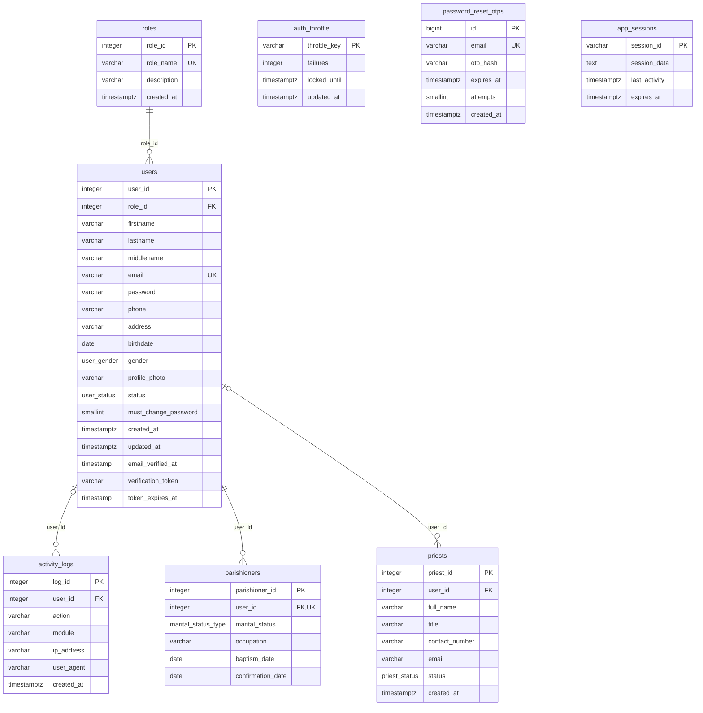
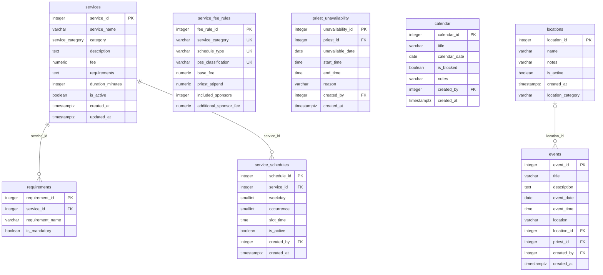
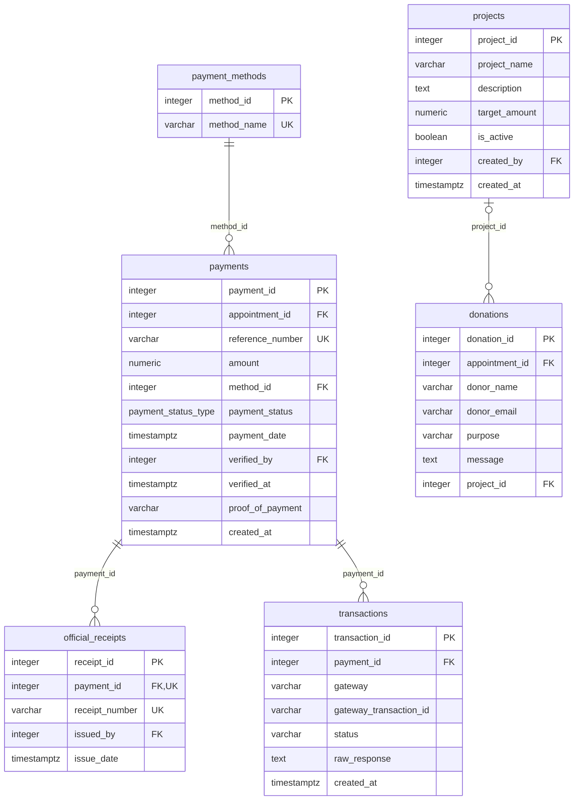
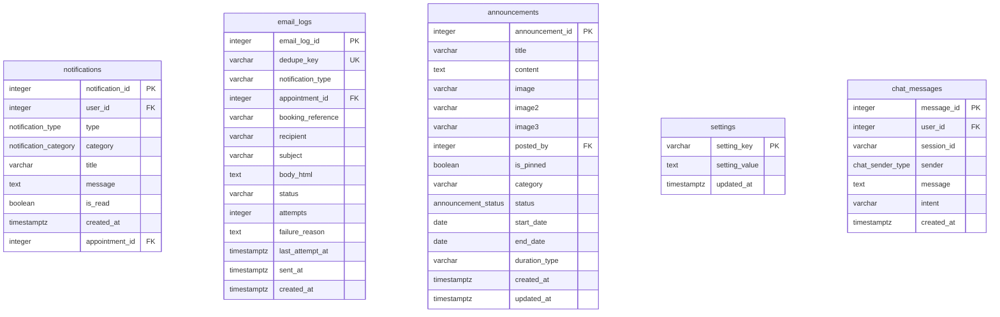

# ParishHub — Database ERD and Data Dictionary

Generated 2026-10-25 from the **verified final schema** (`DATABASE_SCHEMA_FINAL.sql`): the base schema plus every migration replayed into a disposable PostgreSQL instance, with `cleanup_audit.sql` applied and `DATABASE_MIGRATION_SAFE.sql` Part A. Table and column names, types, keys and relationships come straight from the database catalog, not from the old manuscript. **34 tables, 332 columns, 52 foreign keys.**

The diagrams are [Mermaid](https://mermaid.js.org/) source, so they stay editable. They render on GitHub and in VS Code (Markdown Preview Mermaid Support extension), and can be pasted into mermaid.live to export a PNG/SVG for the manuscript's Figure 39.

## 1. Relationship overview (all tables, keys only)

Notation: `||--o{` = one-to-many, `|o--o{` = optional parent (nullable FK). Labels are the FK column and its ON DELETE rule.

```mermaid
erDiagram

    users |o--o{ activity_logs : "user_id (set null)"
    users ||--o{ announcements : "posted_by (cascade)"
    appointments |o--o{ appointment_drafts : "finalized_appointment_id (restrict)"
    parishioners |o--o{ appointment_drafts : "parishioner_id (cascade)"
    priests |o--o{ appointment_drafts : "priest_id (set null)"
    services ||--o{ appointment_drafts : "service_id (restrict)"
    users |o--o{ appointments : "approved_by (set null)"
    users |o--o{ appointments : "confirmed_by (set null)"
    parishioners ||--o{ appointments : "parishioner_id (cascade)"
    priests |o--o{ appointments : "priest_id (set null)"
    users |o--o{ appointments : "pss_verified_by (set null)"
    services ||--o{ appointments : "service_id (no action)"
    appointment_status ||--o{ appointments : "status_id (no action)"
    users |o--o{ calendar : "created_by (set null)"
    users |o--o{ chat_messages : "user_id (set null)"
    appointments ||--o{ donations : "appointment_id (cascade)"
    projects |o--o{ donations : "project_id (set null)"
    appointments |o--o{ email_logs : "appointment_id (set null)"
    users |o--o{ events : "created_by (set null)"
    locations |o--o{ events : "location_id (set null)"
    priests |o--o{ events : "priest_id (set null)"
    appointments |o--o{ generated_forms : "appointment_id (cascade)"
    uploaded_documents |o--o{ generated_forms : "document_id (set null)"
    appointment_drafts |o--o{ generated_forms : "draft_id (cascade)"
    appointments ||--o{ issued_certificates : "appointment_id (cascade)"
    users |o--o{ issued_certificates : "claimed_by_user_id (set null)"
    uploaded_documents |o--o{ issued_certificates : "document_id (set null)"
    users |o--o{ issued_certificates : "issued_by (set null)"
    appointments |o--o{ issued_certificates : "source_appointment_id (set null)"
    appointments ||--o{ mass_intentions : "appointment_id (cascade)"
    appointments |o--o{ notifications : "appointment_id (cascade)"
    users ||--o{ notifications : "user_id (cascade)"
    users |o--o{ official_receipts : "issued_by (no action)"
    payments ||--o| official_receipts : "payment_id (cascade)"
    users ||--o| parishioners : "user_id (cascade)"
    appointments ||--o{ payments : "appointment_id (cascade)"
    payment_methods ||--o{ payments : "method_id (no action)"
    users |o--o{ payments : "verified_by (set null)"
    users |o--o{ priest_unavailability : "created_by (set null)"
    priests ||--o{ priest_unavailability : "priest_id (cascade)"
    users |o--o{ priests : "user_id (set null)"
    users |o--o{ projects : "created_by (set null)"
    services ||--o{ requirements : "service_id (cascade)"
    users |o--o{ service_schedules : "created_by (set null)"
    services ||--o{ service_schedules : "service_id (cascade)"
    payments ||--o{ transactions : "payment_id (cascade)"
    appointments |o--o{ uploaded_documents : "appointment_id (cascade)"
    appointment_drafts |o--o{ uploaded_documents : "draft_id (cascade)"
    requirements |o--o{ uploaded_documents : "requirement_id (set null)"
    users |o--o{ uploaded_documents : "reviewed_by (set null)"
    uploaded_documents |o--o{ uploaded_documents : "superseded_by (set null)"
    roles ||--o{ users : "role_id (no action)"
    app_sessions {
        varchar session_id PK
    }
    auth_throttle {
        varchar throttle_key PK
    }
    password_reset_otps {
        bigint id PK
    }
    service_fee_rules {
        integer fee_rule_id PK
    }
    settings {
        varchar setting_key PK
    }
```

## 2.1 Accounts & security — full columns

Cross-group links: `announcements.posted_by → users`, `appointment_drafts.parishioner_id → parishioners`, `appointment_drafts.priest_id → priests`, `appointments.approved_by → users`, `appointments.confirmed_by → users`, `appointments.parishioner_id → parishioners`, `appointments.priest_id → priests`, `appointments.pss_verified_by → users`, `calendar.created_by → users`, `chat_messages.user_id → users`, `events.created_by → users`, `events.priest_id → priests`, `issued_certificates.claimed_by_user_id → users`, `issued_certificates.issued_by → users`, `notifications.user_id → users`, `official_receipts.issued_by → users`, `payments.verified_by → users`, `priest_unavailability.created_by → users`, `priest_unavailability.priest_id → priests`, `projects.created_by → users`, `service_schedules.created_by → users`, `uploaded_documents.reviewed_by → users`.

## 2.2 Services & scheduling — full columns

Cross-group links: `appointment_drafts.service_id → services`, `appointments.service_id → services`, `calendar.created_by → users`, `events.created_by → users`, `events.priest_id → priests`, `priest_unavailability.created_by → users`, `priest_unavailability.priest_id → priests`, `service_schedules.created_by → users`, `uploaded_documents.requirement_id → requirements`.

## 2.3 Bookings, forms & documents — full columns

```mermaid
erDiagram
    appointment_status {
        integer status_id PK
        varchar status_name UK
    }
    appointments {
        integer appointment_id PK
        integer parishioner_id FK
        integer service_id FK
        integer priest_id FK
        date appointment_date
        time appointment_time
        integer status_id FK
        text remarks
        integer approved_by FK
        timestamptz approved_at
        integer confirmed_by FK
        timestamptz confirmed_at
        varchar cancelled_reason
        date date_of_death
        varchar schedule_type
        varchar guest_name
        varchar guest_email
        varchar guest_phone
        varchar guest_reference UK
        varchar contact_phone
        text location_address
        timestamptz created_at
        timestamptz updated_at
        varchar rejection_reason
        varchar pss_classification
        varchar pss_claim
        integer sponsor_count
        integer wedding_sponsor_count
        jsonb fee_snapshot
        integer pss_verified_by FK
        timestamp pss_verified_at
        jsonb requirements_snapshot
        varchar requester_name
        varchar patient_name
        varchar requirements_review_status
        timestamptz revision_requested_at
        varchar precana_type
        date precana_date
        time precana_time
        varchar precana_status
        date preferred_burial_date
        time preferred_burial_time
        timestamptz payment_deadline
        text outside_priest_name
    }
    appointment_drafts {
        bigint draft_id PK
        varchar service_type
        integer parishioner_id FK
        character guest_access_token_hash UK
        varchar guest_name
        varchar guest_email
        varchar guest_phone
        integer service_id FK
        integer priest_id FK
        date appointment_date
        time appointment_time
        varchar schedule_type
        varchar pss_claim
        integer sponsor_count
        integer wedding_sponsor_count
        text remarks
        varchar contact_phone
        text location_address
        varchar status
        timestamptz created_at
        timestamptz updated_at
        timestamptz expires_at
        integer finalized_appointment_id FK
        varchar precana_type
        date precana_date
        time precana_time
        varchar precana_status
        text outside_priest_name
    }
    generated_forms {
        bigint generated_form_id PK
        varchar service_category
        integer appointment_id FK
        bigint draft_id FK
        varchar form_type
        jsonb form_data
        integer document_id FK
        varchar status
        text rejection_reason
        timestamptz created_at
        timestamptz updated_at
    }
    uploaded_documents {
        integer document_id PK
        integer appointment_id FK
        integer requirement_id FK
        varchar requirement_label
        varchar file_name
        varchar file_path
        varchar file_type
        timestamptz uploaded_at
        boolean verified
        varchar review_status
        text rejection_reason
        integer reviewed_by FK
        timestamptz reviewed_at
        integer superseded_by FK
        varchar document_source
        varchar generated_form_type
        bigint draft_id FK
    }
    issued_certificates {
        bigint issued_certificate_id PK
        integer appointment_id FK
        integer source_appointment_id FK
        varchar certificate_type
        varchar book_no
        varchar page_no
        varchar line_no
        date registry_date
        varchar certificate_purpose
        jsonb form_data
        integer document_id FK
        varchar status
        integer issued_by FK
        timestamptz issued_at
        timestamptz created_at
        timestamptz updated_at
        timestamptz claimed_at
        bigint claimed_by_user_id FK
    }
    mass_intentions {
        integer intention_id PK
        integer appointment_id FK
        mass_intention_type intention_type
        varchar offerer_name
        varchar intention_for
        text message
    }
    appointments |o--o{ appointment_drafts : "finalized_appointment_id"
    appointment_status ||--o{ appointments : "status_id"
    appointments |o--o{ generated_forms : "appointment_id"
    uploaded_documents |o--o{ generated_forms : "document_id"
    appointment_drafts |o--o{ generated_forms : "draft_id"
    appointments ||--o{ issued_certificates : "appointment_id"
    uploaded_documents |o--o{ issued_certificates : "document_id"
    appointments |o--o{ issued_certificates : "source_appointment_id"
    appointments ||--o{ mass_intentions : "appointment_id"
    appointments |o--o{ uploaded_documents : "appointment_id"
    appointment_drafts |o--o{ uploaded_documents : "draft_id"
    uploaded_documents |o--o{ uploaded_documents : "superseded_by"
```

Cross-group links: `appointment_drafts.parishioner_id → parishioners`, `appointment_drafts.priest_id → priests`, `appointment_drafts.service_id → services`, `appointments.approved_by → users`, `appointments.confirmed_by → users`, `appointments.parishioner_id → parishioners`, `appointments.priest_id → priests`, `appointments.pss_verified_by → users`, `appointments.service_id → services`, `donations.appointment_id → appointments`, `email_logs.appointment_id → appointments`, `issued_certificates.claimed_by_user_id → users`, `issued_certificates.issued_by → users`, `notifications.appointment_id → appointments`, `payments.appointment_id → appointments`, `uploaded_documents.requirement_id → requirements`, `uploaded_documents.reviewed_by → users`.

## 2.4 Payments & donations — full columns

Cross-group links: `donations.appointment_id → appointments`, `official_receipts.issued_by → users`, `payments.appointment_id → appointments`, `payments.verified_by → users`, `projects.created_by → users`.

## 2.5 Communication & content — full columns

Cross-group links: `announcements.posted_by → users`, `chat_messages.user_id → users`, `email_logs.appointment_id → appointments`, `notifications.appointment_id → appointments`, `notifications.user_id → users`.

## 3. Chapter 2 data dictionary (verified)

Use this to update the manuscript's Database Design tables. Each entry gives the actual table name, its purpose, and every column with its type, key, nullability and description. Descriptions are reused from the current manuscript where the column already existed; new columns are described from their source migration. Status: **ACTIVE** unless marked.

**Changes vs. the manuscript's Database Design:**
- Tables 18–19 (`Generated_wedding_forms`, `Generated_baptism_forms`) → one table, `generated_forms`.
- Tables 20–21 (`Wedding_booking_drafts`, `Baptism_booking_drafts`) → one table, `appointment_drafts`.
- New tables: `auth_throttle`, `password_reset_otps`, `email_logs`, `app_sessions`, `issued_certificates`.
- Removed by `cleanup_audit.sql`: `permissions`, `role_permissions`, `reports`; `users.remember_token`, `official_receipts.pdf_path`, `events.calendar_id`, `parishioners.emergency_contact_name/number`.
- `requirements` and `chat_messages` still exist but no current code reads them.

### Table 1. roles

User roles (Parishioner, Secretary, Treasurer — shown as “Cashier” —, Admin, Priest).

| Field | Data type | Key | Null | Description |
|---|---|---|---|---|
| role_id | integer | PK | NO | Unique identifier of each role (ids are used directly by the code). |
| role_name | varchar(50) | UNIQUE | NO | Role name stored in the system: Parishioner, Secretary, Treasurer (displayed as "Cashier"), Admin, Priest. |
| description | varchar(255) |  | YES | Description of the role. |
| created_at | timestamptz |  | YES | Date and time the record was created. |

### Table 2. users

Login accounts for parishioners, staff, and priests (plus one login-disabled guest placeholder).

| Field | Data type | Key | Null | Description |
|---|---|---|---|---|
| user_id | integer | PK | NO | Unique identifier of each user. |
| role_id | integer | FK → roles.role_id | NO | Identifier of the user’s role. |
| firstname | varchar(100) |  | NO | First name of the user. |
| lastname | varchar(100) |  | NO | Last name of the user. |
| middlename | varchar(100) |  | YES | Middle name of the user (optional). |
| email | varchar(150) | UNIQUE | NO | Unique email address used for logging in. |
| password | varchar(255) |  | NO | Encrypted (hashed) password of the user. |
| phone | varchar(20) |  | YES | Mobile number of the user. |
| address | varchar(255) |  | YES | Address of the user. |
| birthdate | date |  | YES | Birthdate of the user. |
| gender | user_gender |  | YES | Gender of the user (Male or Female). |
| profile_photo | varchar(255) |  | YES | File path of the profile photo. |
| status | user_status |  | YES | Account status (active, inactive, or suspended). |
| must_change_password | smallint |  | YES | Forces the user to change their password on next login (e.g., staff accounts created by the administrator). |
| created_at | timestamptz |  | YES | Date and time the account was created. |
| updated_at | timestamptz |  | YES | Date and time the account was last updated. |
| email_verified_at | timestamp |  | YES | Date and time the email was verified. |
| verification_token | varchar(64) |  | YES | Token emailed to the user to confirm their email address. |
| token_expires_at | timestamp |  | YES | Expiry date and time of the email verification token. |

### Table 3. parishioners

Parishioner profile linked to a user account.

| Field | Data type | Key | Null | Description |
|---|---|---|---|---|
| parishioner_id | integer | PK | NO | Unique identifier of each parishioner. |
| user_id | integer | FK → users.user_id, UNIQUE | NO | Identifier of the parishioner’s user account. |
| marital_status | marital_status_type |  | YES | Marital status (Single, Married, Widowed, or Separated). |
| occupation | varchar(100) |  | YES | Occupation of the parishioner. |
| baptism_date | date |  | YES | Date of baptism (optional; re-added by the cleanup because the secretary’s parishioner page reads it). |
| confirmation_date | date |  | YES | Date of confirmation (optional; see baptism_date). |

### Table 4. priests

Priests who can be assigned to services (optionally linked to a priest login).

| Field | Data type | Key | Null | Description |
|---|---|---|---|---|
| priest_id | integer | PK | NO | Unique identifier of each priest. |
| user_id | integer | FK → users.user_id | YES | Identifier of the priest’s portal account, if any. |
| full_name | varchar(150) |  | NO | Full name of the priest. |
| title | varchar(50) |  | YES | Title of the priest (e.g., Rev. Fr.). |
| contact_number | varchar(20) |  | YES | Contact number of the priest. |
| email | varchar(150) |  | YES | Email address of the priest. |
| status | priest_status |  | YES | Status of the priest (active, on_leave, or inactive). |
| created_at | timestamptz |  | YES | Date and time the record was created. |

### Table 5. auth_throttle

Failed-login / guest-lookup counters used to lock out brute-force attempts.

| Field | Data type | Key | Null | Description |
|---|---|---|---|---|
| throttle_key | varchar(190) | PK | NO | Hashed key: login email, IP address, or guest-lookup scope. |
| failures | integer |  | NO | Consecutive failed attempts. |
| locked_until | timestamptz |  | YES | Lockout end time (NULL when not locked). |
| updated_at | timestamptz |  | NO | Last update. |

### Table 6. password_reset_otps

One-time codes for self-service password reset.

| Field | Data type | Key | Null | Description |
|---|---|---|---|---|
| id | bigint | PK | NO | Unique identifier. |
| email | varchar(150) | UNIQUE | NO | Account email (one pending code per email). |
| otp_hash | varchar(255) |  | NO | Bcrypt hash of the 6-digit code. |
| expires_at | timestamptz |  | NO | Code expiry (10 minutes). |
| attempts | smallint |  | NO | Wrong-code attempts (max 5). |
| created_at | timestamptz |  | NO | When the code was issued. |

### Table 7. app_sessions — CONDITIONAL

Database-backed PHP sessions (used only when SESSION_DRIVER=database).

| Field | Data type | Key | Null | Description |
|---|---|---|---|---|
| session_id | varchar(128) | PK | NO | PHP session id. |
| session_data | text |  | NO | Serialized session data. |
| last_activity | timestamptz |  | NO | Last request time. |
| expires_at | timestamptz |  | NO | Session expiry. |

### Table 8. activity_logs

Audit trail of user actions (written by PHP and by a status-change trigger).

| Field | Data type | Key | Null | Description |
|---|---|---|---|---|
| log_id | integer | PK | NO | Unique identifier of each log. |
| user_id | integer | FK → users.user_id | YES | User who performed the action. |
| action | varchar(150) |  | NO | Description of the action. |
| module | varchar(100) |  | YES | Module where the action was performed. |
| ip_address | varchar(45) |  | YES | IP address of the user. |
| user_agent | varchar(255) |  | YES | Browser information of the user. |
| created_at | timestamptz |  | YES | Date and time of the action. |

### Table 9. services

Bookable parish services and their fees and requirement lists.

| Field | Data type | Key | Null | Description |
|---|---|---|---|---|
| service_id | integer | PK | NO | Unique identifier of each service. |
| service_name | varchar(150) |  | NO | Name of the service. |
| category | service_category |  | NO | Category of the service (Mass Intention, Wedding, Baptism, Funeral, Blessing, Confirmation, First Communion, Donation). |
| description | text |  | YES | Description of the service. |
| fee | numeric(10,2) |  | NO | Default fee of the service. |
| requirements | text |  | YES | Requirements of the service. |
| duration_minutes | integer |  | YES | Estimated duration of the service. |
| is_active | boolean |  | YES | Indicates whether the service can be booked. |
| created_at | timestamptz |  | YES | Date and time the service was created. |
| updated_at | timestamptz |  | YES | Date and time the service was last updated. |

### Table 10. service_schedules

Regular (fixed) schedule slots per service.

| Field | Data type | Key | Null | Description |
|---|---|---|---|---|
| schedule_id | integer | PK | NO | Unique identifier of each schedule. |
| service_id | integer | FK → services.service_id | NO | Identifier of the service. |
| weekday | smallint |  | NO | Day of the week (0 = Sunday to 6 = Saturday). |
| occurrence | smallint |  | YES | Occurrence of the weekday in the month (1st to 5th; blank for every week). |
| slot_time | time |  | NO | Fixed time of the schedule. |
| is_active | boolean |  | YES | Indicates whether the schedule is active. |
| created_by | integer | FK → users.user_id | YES | User who created the schedule. |
| created_at | timestamptz |  | YES | Date and time the schedule was created. |

### Table 11. service_fee_rules

Fee rules for Baptism/Wedding/Funeral by schedule type and PSS classification (server-side only).

| Field | Data type | Key | Null | Description |
|---|---|---|---|---|
| fee_rule_id | integer | PK | NO | Unique identifier. |
| service_category | varchar(50) | UNIQUE | NO | Service category covered by the rule. |
| schedule_type | varchar(10) | UNIQUE | NO | Schedule type (Regular, Special, or Any). |
| pss_classification | varchar(20) | UNIQUE | NO | PSS classification (pss or non_pss). |
| base_fee | numeric(10,2) |  | NO | Base fee of the service. |
| priest_stipend | numeric(10,2) |  | NO | Stipend for the priest. |
| included_sponsors | integer |  | NO | Number of sponsors included in the fee. |
| additional_sponsor_fee | numeric(10,2) |  | NO | Fee for each additional sponsor. |

### Table 12. requirements — UNUSED (FK target only)

Legacy normalized requirement list (not read by current code; requirement lists live in services.requirements).

| Field | Data type | Key | Null | Description |
|---|---|---|---|---|
| requirement_id | integer | PK | NO | Unique identifier of each requirement. |
| service_id | integer | FK → services.service_id | NO | Identifier of the service. |
| requirement_name | varchar(150) |  | NO | Name of the required document. |
| is_mandatory | boolean |  | YES | Indicates whether the requirement is mandatory. |

### Table 13. priest_unavailability

Dates/times when a priest cannot be scheduled.

| Field | Data type | Key | Null | Description |
|---|---|---|---|---|
| unavailability_id | integer | PK | NO | Unique identifier of each record. |
| priest_id | integer | FK → priests.priest_id | NO | Identifier of the priest. |
| unavailable_date | date |  | NO | Date when the priest is unavailable. |
| start_time | time |  | YES | Start of the unavailable period (blank for whole day). |
| end_time | time |  | YES | End of the unavailable period (blank for whole day). |
| reason | varchar(255) |  | YES | Reason for the unavailability. |
| created_by | integer | FK → users.user_id | YES | User who recorded the unavailability. |
| created_at | timestamptz |  | YES | Date and time the record was created. |

### Table 14. calendar

Parish calendar entries, including blocked dates.

| Field | Data type | Key | Null | Description |
|---|---|---|---|---|
| calendar_id | integer | PK | NO | Unique identifier of each calendar date. |
| title | varchar(150) |  | NO | Title of the date entry. |
| calendar_date | date |  | NO | Date of the entry. |
| is_blocked | boolean |  | YES | Indicates whether bookings are blocked on the date. |
| notes | varchar(255) |  | YES | Notes about the date. |
| created_by | integer | FK → users.user_id | YES | User who created the entry. |
| created_at | timestamptz |  | YES | Date and time the entry was created. |

### Table 15. events

Parish events shown on the calendar.

| Field | Data type | Key | Null | Description |
|---|---|---|---|---|
| event_id | integer | PK | NO | Unique identifier of each event. |
| title | varchar(150) |  | NO | Title of the event. |
| description | text |  | YES | Description of the event. |
| event_date | date |  | NO | Date of the event. |
| event_time | time |  | YES | Time of the event. |
| location | varchar(150) |  | YES | Location text of the event. |
| location_id | integer | FK → locations.location_id | YES | Identifier of the managed location. |
| priest_id | integer | FK → priests.priest_id | YES | Identifier of the assigned priest. |
| created_by | integer | FK → users.user_id | YES | User who created the event. |
| created_at | timestamptz |  | YES | Date and time the event was created. |

### Table 16. locations

Locations used for parish events.

| Field | Data type | Key | Null | Description |
|---|---|---|---|---|
| location_id | integer | PK | NO | Unique identifier of each location. |
| name | varchar(150) |  | NO | Name of the location. |
| notes | varchar(255) |  | YES | Notes about the location. |
| is_active | boolean |  | YES | Indicates whether the location is active. |
| created_at | timestamptz |  | YES | Date and time the location was created. |
| location_category | varchar(20) |  | NO | Category (barangay, school, chapel, or other). |

### Table 17. appointment_status

Appointment status lookup (ids 1–7 are used directly by the code).

| Field | Data type | Key | Null | Description |
|---|---|---|---|---|
| status_id | integer | PK | NO | Unique identifier of each status. |
| status_name | varchar(50) | UNIQUE | NO | Name of the status (Pending, Approved, Rejected, Payment Verified, Confirmed, Completed, Cancelled). |

### Table 18. appointments

Every service request: sacraments, Mass intentions, donations, certificate requests, member and guest.

| Field | Data type | Key | Null | Description |
|---|---|---|---|---|
| appointment_id | integer | PK | NO | Unique identifier of each appointment. |
| parishioner_id | integer | FK → parishioners.parishioner_id | NO | Identifier of the parishioner who made the request. |
| service_id | integer | FK → services.service_id | NO | Identifier of the requested service. |
| priest_id | integer | FK → priests.priest_id | YES | Identifier of the assigned priest. |
| appointment_date | date |  | YES | Scheduled date of the service. |
| appointment_time | time |  | YES | Scheduled time of the service. |
| status_id | integer | FK → appointment_status.status_id | NO | Current status of the appointment. |
| remarks | text |  | YES | Additional remarks of the requester. |
| approved_by | integer | FK → users.user_id | YES | User who approved the request. |
| approved_at | timestamptz |  | YES | Date and time of approval. |
| confirmed_by | integer | FK → users.user_id | YES | User who confirmed the appointment. |
| confirmed_at | timestamptz |  | YES | Date and time of confirmation. |
| cancelled_reason | varchar(255) |  | YES | Reason for cancellation. |
| date_of_death | date |  | YES | Date of death (funeral Masses only). |
| schedule_type | varchar(10) |  | YES | Schedule type (Regular or Special). |
| guest_name | varchar(150) |  | YES | Name of the guest requester. |
| guest_email | varchar(150) |  | YES | Email of the guest requester. |
| guest_phone | varchar(20) |  | YES | Mobile number of the guest requester. |
| guest_reference | varchar(20) | UNIQUE | YES | Unique reference code given to the guest. |
| contact_phone | varchar(20) |  | YES | Contact number for the service (e.g., house blessing). |
| location_address | text |  | YES | Location of the service (e.g., house blessing). |
| created_at | timestamptz |  | YES | Date and time the request was submitted. |
| updated_at | timestamptz |  | YES | Date and time the request was last updated. |
| rejection_reason | varchar(255) |  | YES | Reason for rejection. |
| pss_classification | varchar(20) |  | YES | PSS classification verified by the secretary. |
| pss_claim | varchar(20) |  | YES | PSS classification claimed by the requester. |
| sponsor_count | integer |  | YES | Number of baptismal sponsors. |
| wedding_sponsor_count | integer |  | YES | Number of wedding sponsors. |
| fee_snapshot | jsonb |  | YES | Saved computation of the service fee. |
| pss_verified_by | integer | FK → users.user_id | YES | User who verified the PSS classification. |
| pss_verified_at | timestamp |  | YES | Date and time of PSS verification. |
| requirements_snapshot | jsonb |  | YES | Saved list of requirements at the time of booking. |
| requester_name | varchar(150) |  | YES | Name of the person requesting the Anointing of the Sick. |
| patient_name | varchar(150) |  | YES | Name of the sick person for whom the Anointing is requested. |
| requirements_review_status | varchar(30) |  | YES | Requirements re-review state: NULL = pending review, awaiting_revision, ready_for_rereview. |
| revision_requested_at | timestamptz |  | YES | Date and time a document revision or re-upload was requested. |
| precana_type | varchar(10) |  | YES | Type of Pre-Cana seminar scheduled for the wedding (Regular or Special). |
| precana_date | date |  | YES | Scheduled date of the Pre-Cana seminar. |
| precana_time | time |  | YES | Scheduled time of the Pre-Cana seminar. |
| precana_status | varchar(20) |  | YES | Pre-Cana scheduling status (scheduled, pending_confirmation, proposed, confirmed). |
| preferred_burial_date | date |  | YES | Family’s preferred burial date, subject to the secretary’s confirmation. |
| preferred_burial_time | time |  | YES | Family’s preferred burial time, subject to the secretary’s confirmation. |
| payment_deadline | timestamptz |  | YES | Deadline by which payment must be verified for the appointment. |
| outside_priest_name | text |  | YES | Name of a visiting priest, not on the parish list, requested to officiate. |

### Table 19. appointment_drafts

Unfinished Wedding/Baptism bookings while forms and documents are completed (replaces wedding_booking_drafts and baptism_booking_drafts).

| Field | Data type | Key | Null | Description |
|---|---|---|---|---|
| draft_id | bigint | PK | NO | Unique identifier of each draft. |
| service_type | varchar(20) |  | NO | Wedding or Baptism. |
| parishioner_id | integer | FK → parishioners.parishioner_id | YES | Identifier of the parishioner (blank for guests). |
| guest_access_token_hash | character(64) | UNIQUE | YES | SHA-256 hash of the guest’s draft access token (guests only). |
| guest_name | varchar(255) |  | YES | Contact details of the guest. |
| guest_email | varchar(255) |  | YES | Contact details of the guest. |
| guest_phone | varchar(30) |  | YES | Contact details of the guest. |
| service_id | integer | FK → services.service_id | NO | Identifier of the service. |
| priest_id | integer | FK → priests.priest_id | YES | Identifier of the selected priest. |
| appointment_date | date |  | YES | Selected schedule. |
| appointment_time | time |  | YES | Selected schedule. |
| schedule_type | varchar(20) |  | YES | Regular or Special schedule. |
| pss_claim | varchar(20) |  | YES | Claimed PSS classification. |
| sponsor_count | integer |  | YES | Number of sponsors. |
| wedding_sponsor_count | integer |  | YES | Number of sponsors. |
| remarks | text |  | YES | Remarks of the requester. |
| contact_phone | varchar(30) |  | YES | Contact number for the booking. |
| location_address | text |  | YES | Location of the service, where applicable. |
| status | varchar(20) |  | NO | Status of the draft (draft, finalized, expired, abandoned). |
| created_at | timestamptz |  | NO | Date and time created and updated. |
| updated_at | timestamptz |  | NO | Date and time created and updated. |
| expires_at | timestamptz |  | NO | When an unfinished draft expires (24 hours). |
| finalized_appointment_id | integer | FK → appointments.appointment_id | YES | Appointment created when the draft was submitted. |
| precana_type | varchar(10) |  | YES | Pre-Cana seminar type (Regular or Special). |
| precana_date | date |  | YES | Pre-Cana seminar date. |
| precana_time | time |  | YES | Pre-Cana seminar time. |
| precana_status | varchar(20) |  | YES | Pre-Cana scheduling status. |
| outside_priest_name | text |  | YES | Name of a visiting priest requested to officiate. |

### Table 20. generated_forms

Forms filled out online and generated by the system for Wedding, Baptism, and Funeral (replaces generated_wedding_forms, generated_baptism_forms, generated_funeral_forms).

| Field | Data type | Key | Null | Description |
|---|---|---|---|---|
| generated_form_id | bigint | PK | NO | Unique identifier of each generated form. |
| service_category | varchar(20) |  | NO | Service the form belongs to (Wedding, Baptism, or Funeral). |
| appointment_id | integer | FK → appointments.appointment_id | YES | Related appointment (set once the booking is submitted). |
| draft_id | bigint | FK → appointment_drafts.draft_id | YES | Related booking draft (set while the booking is still a draft). |
| form_type | varchar(60) |  | NO | Form identifier, e.g. matrimony_application, katin_awan_bunyag, katin_awan_paglubong. |
| form_data | jsonb |  | NO | Filled-in form fields (JSON). |
| document_id | integer | FK → uploaded_documents.document_id | YES | Generated PDF stored in uploaded_documents. |
| status | varchar(30) |  | NO | draft, generated, pending_review, approved, or rejected. |
| rejection_reason | text |  | YES | Secretary’s reason when the form is rejected. |
| created_at | timestamptz |  | NO | Date and time the form was created. |
| updated_at | timestamptz |  | NO | Date and time the form was last updated. |

### Table 21. uploaded_documents

Uploaded and generated documents, with per-document review status.

| Field | Data type | Key | Null | Description |
|---|---|---|---|---|
| document_id | integer | PK | NO | Unique identifier of each document. |
| appointment_id | integer | FK → appointments.appointment_id | YES | Identifier of the related appointment. |
| requirement_id | integer | FK → requirements.requirement_id | YES | Identifier of the related requirement. |
| requirement_label | varchar(255) |  | YES | Name of the requirement the file satisfies. |
| file_name | varchar(255) |  | NO | Original name of the file. |
| file_path | varchar(255) |  | NO | Storage path of the file. |
| file_type | varchar(50) |  | YES | Type of the file. |
| uploaded_at | timestamptz |  | YES | Date and time of upload. |
| verified | boolean |  | YES | Indicates whether the document is verified. |
| review_status | varchar(20) |  | YES | Review status (pending, approved, or rejected). |
| rejection_reason | text |  | YES | Reason the document was rejected. |
| reviewed_by | integer | FK → users.user_id | YES | User who reviewed the document. |
| reviewed_at | timestamptz |  | YES | Date and time of review. |
| superseded_by | integer | FK → uploaded_documents.document_id | YES | Replacement document of a rejected file. |
| document_source | varchar(20) |  | NO | Source of the document (uploaded or generated). |
| generated_form_type | varchar(50) |  | YES | Type of generated form, if any. |
| draft_id | bigint | FK → appointment_drafts.draft_id | YES | Related booking draft (Wedding or Baptism) in appointment_drafts; exactly one of appointment_id / draft_id is set. |

### Table 22. issued_certificates

Official parish certificates issued, with register references and pickup tracking.

| Field | Data type | Key | Null | Description |
|---|---|---|---|---|
| issued_certificate_id | bigint | PK | NO | Unique identifier of each issued certificate. |
| appointment_id | integer | FK → appointments.appointment_id | NO | Sacrament appointment (first issuance) or Certificate Request appointment (re-issuance). |
| source_appointment_id | integer | FK → appointments.appointment_id | YES | Original sacrament appointment matched for a re-issuance. |
| certificate_type | varchar(20) |  | NO | Baptism, Marriage, Confirmation, or Death. |
| book_no | varchar(50) |  | YES | Parish register book number. |
| page_no | varchar(50) |  | YES | Parish register page number. |
| line_no | varchar(50) |  | YES | Parish register line/entry number. |
| registry_date | date |  | YES | Date recorded in the parish register. |
| certificate_purpose | varchar(150) |  | YES | Purpose stated on the certificate. |
| form_data | jsonb |  | NO | Certificate field values (JSON). |
| document_id | integer | FK → uploaded_documents.document_id | YES | Generated certificate PDF in uploaded_documents. |
| status | varchar(20) |  | NO | draft, generated, ready_for_pickup, or claimed. |
| issued_by | integer | FK → users.user_id | YES | Staff user who issued the certificate. |
| issued_at | timestamptz |  | YES | Date and time of issuance. |
| created_at | timestamptz |  | NO | Date and time the record was created. |
| updated_at | timestamptz |  | NO | Date and time the record was last updated. |
| claimed_at | timestamptz |  | YES | Date and time the certificate was picked up. |
| claimed_by_user_id | bigint | FK → users.user_id | YES | Staff user who recorded the pickup. |

### Table 23. mass_intentions

Mass intention details for a Mass Intention appointment.

| Field | Data type | Key | Null | Description |
|---|---|---|---|---|
| intention_id | integer | PK | NO | Unique identifier of each Mass intention. |
| appointment_id | integer | FK → appointments.appointment_id | NO | Identifier of the related appointment. |
| intention_type | mass_intention_type |  | NO | Type of intention (Living, Dead, Thanksgiving, Healing, Birthday). |
| offerer_name | varchar(150) |  | NO | Name of the person offering the Mass. |
| intention_for | varchar(255) |  | NO | Person or intention prayed for. |
| message | text |  | YES | Optional message to be read. |

### Table 24. payment_methods

Payment method lookup (ids are used directly by the code; 7 = PayMongo).

| Field | Data type | Key | Null | Description |
|---|---|---|---|---|
| method_id | integer | PK | NO | Unique identifier of each method. |
| method_name | varchar(50) | UNIQUE | NO | Name of the method (Cash, GCash, Maya, Bank Transfer, Card, PayPal, PayMongo). |

### Table 25. payments

Payments for appointments (cash or PayMongo).

| Field | Data type | Key | Null | Description |
|---|---|---|---|---|
| payment_id | integer | PK | NO | Unique identifier of each payment. |
| appointment_id | integer | FK → appointments.appointment_id | NO | Identifier of the related appointment. |
| reference_number | varchar(100) | UNIQUE | YES | Reference number of the payment. |
| amount | numeric(10,2) |  | NO | Amount paid. |
| method_id | integer | FK → payment_methods.method_id | NO | Identifier of the payment method. |
| payment_status | payment_status_type |  | YES | Status (pending, verified, failed, refunded, cancelled). |
| payment_date | timestamptz |  | YES | Date and time of payment. |
| verified_by | integer | FK → users.user_id | YES | Cashier who verified the payment. |
| verified_at | timestamptz |  | YES | Date and time of verification. |
| proof_of_payment | varchar(255) |  | YES | File path of the proof of payment. |
| created_at | timestamptz |  | YES | Date and time the record was created. |

### Table 26. transactions

Raw payment-gateway (PayMongo) records.

| Field | Data type | Key | Null | Description |
|---|---|---|---|---|
| transaction_id | integer | PK | NO | Unique identifier of each transaction. |
| payment_id | integer | FK → payments.payment_id | NO | Identifier of the related payment. |
| gateway | varchar(50) |  | YES | Payment gateway used (PayMongo). |
| gateway_transaction_id | varchar(150) |  | YES | Checkout session identifier from the gateway. |
| status | varchar(50) |  | YES | Status returned by the gateway. |
| raw_response | text |  | YES | Response received from the gateway. |
| created_at | timestamptz |  | YES | Date and time the record was created. |

### Table 27. official_receipts

Official receipts; receipt_number is generated by a database trigger.

| Field | Data type | Key | Null | Description |
|---|---|---|---|---|
| receipt_id | integer | PK | NO | Unique identifier of each receipt. |
| payment_id | integer | FK → payments.payment_id, UNIQUE | NO | Identifier of the related payment. |
| receipt_number | varchar(50) | UNIQUE | NO | Unique receipt number (OR-YYYY-000000). |
| issued_by | integer | FK → users.user_id | YES | Cashier who issued the receipt (blank if verified by PayMongo). |
| issue_date | timestamptz |  | YES | Date and time the receipt was issued. |

### Table 28. donations

Donation details for a Donation appointment.

| Field | Data type | Key | Null | Description |
|---|---|---|---|---|
| donation_id | integer | PK | NO | Unique identifier of each donation. |
| appointment_id | integer | FK → appointments.appointment_id | NO | Identifier of the related transaction record. |
| donor_name | varchar(150) |  | YES | Name of the donor (optional). |
| donor_email | varchar(150) |  | YES | Email of the donor (optional). |
| purpose | varchar(50) |  | YES | Purpose of the donation. |
| message | text |  | YES | Optional message of the donor. |
| project_id | integer | FK → projects.project_id | YES | Identifier of the supported ongoing project. |

### Table 29. projects

Ongoing parish projects that donations can support.

| Field | Data type | Key | Null | Description |
|---|---|---|---|---|
| project_id | integer | PK | NO | Unique identifier of each project. |
| project_name | varchar(150) |  | NO | Name of the project. |
| description | text |  | YES | Description of the project. |
| target_amount | numeric(12,2) |  | NO | Target amount of the project. |
| is_active | boolean |  | YES | Indicates whether the project is ongoing. |
| created_by | integer | FK → users.user_id | YES | User who created the project. |
| created_at | timestamptz |  | YES | Date and time the project was created. |

### Table 30. notifications

In-app (website) notifications.

| Field | Data type | Key | Null | Description |
|---|---|---|---|---|
| notification_id | integer | PK | NO | Unique identifier of each notification. |
| user_id | integer | FK → users.user_id | NO | Recipient of the notification. |
| type | notification_type |  | NO | Channel of the notification (email, sms, website). |
| category | notification_category |  | YES | Category (appointment, payment, announcement, system). |
| title | varchar(150) |  | NO | Title of the notification. |
| message | text |  | NO | Message of the notification. |
| is_read | boolean |  | YES | Indicates whether the notification was read. |
| created_at | timestamptz |  | YES | Date and time the notification was created. |
| appointment_id | integer | FK → appointments.appointment_id | YES | Related appointment, if any, so the notification links directly to it. |

### Table 31. email_logs

Outgoing email delivery log with retry and de-duplication.

| Field | Data type | Key | Null | Description |
|---|---|---|---|---|
| email_log_id | integer | PK | NO | Unique identifier. |
| dedupe_key | varchar(255) | UNIQUE | NO | Prevents the same email from being sent twice. |
| notification_type | varchar(40) |  | NO | Kind of email (e.g. revision request, approval). |
| appointment_id | integer | FK → appointments.appointment_id | YES | Related appointment. |
| booking_reference | varchar(40) |  | YES | Booking reference shown in the email. |
| recipient | varchar(150) |  | NO | Recipient email address. |
| subject | varchar(255) |  | NO | Email subject. |
| body_html | text |  | NO | Email body, kept so a failed send can be retried. |
| status | varchar(20) |  | NO | pending, sent, or failed. |
| attempts | integer |  | NO | Send attempts. |
| failure_reason | text |  | YES | Last error, if any. |
| last_attempt_at | timestamptz |  | YES | Last send attempt. |
| sent_at | timestamptz |  | YES | When the email was sent. |
| created_at | timestamptz |  | YES | Date and time the record was created. |

### Table 32. announcements

Published parish announcements.

| Field | Data type | Key | Null | Description |
|---|---|---|---|---|
| announcement_id | integer | PK | NO | Unique identifier of each announcement. |
| title | varchar(200) |  | NO | Title of the announcement. |
| content | text |  | NO | Content of the announcement. |
| image | varchar(255) |  | YES | First (cover) image of the announcement. |
| image2 | varchar(255) |  | YES | Second (optional) image of the announcement. |
| image3 | varchar(255) |  | YES | Third (optional) image of the announcement. |
| posted_by | integer | FK → users.user_id | NO | User who posted the announcement. |
| is_pinned | boolean |  | YES | Indicates whether the announcement is pinned. |
| category | varchar(30) |  | YES | Category of the announcement. |
| status | announcement_status |  | YES | Status (draft, published, or archived). |
| start_date | date |  | YES | Display period of the announcement. |
| end_date | date |  | YES | Display period of the announcement. |
| duration_type | varchar(20) |  | YES | Type of display period (specific date, month, year, custom range). |
| created_at | timestamptz |  | YES | Date and time created and updated. |
| updated_at | timestamptz |  | YES | Date and time created and updated. |

### Table 33. settings

Key/value system settings (e.g. donation_enabled, parish contact details).

| Field | Data type | Key | Null | Description |
|---|---|---|---|---|
| setting_key | varchar(100) | PK | NO | Unique name of the setting. |
| setting_value | text |  | YES | Value of the setting. |
| updated_at | timestamptz |  | YES | Date and time the setting was last updated. |

### Table 34. chat_messages — UNUSED

Unused: chatbot message log (the chatbot stores nothing).

| Field | Data type | Key | Null | Description |
|---|---|---|---|---|
| message_id | integer | PK | NO | Unique identifier of each message. |
| user_id | integer | FK → users.user_id | YES | User who sent the message (blank for visitors). |
| session_id | varchar(100) |  | NO | Chat session identifier. |
| sender | chat_sender_type |  | NO | Sender of the message (user or bot). |
| message | text |  | NO | Content of the message. |
| intent | varchar(100) |  | YES | Detected topic of the message. |
| created_at | timestamptz |  | YES | Date and time the message was sent. |

---

Columns without a description (fill in during the manuscript update): none.
